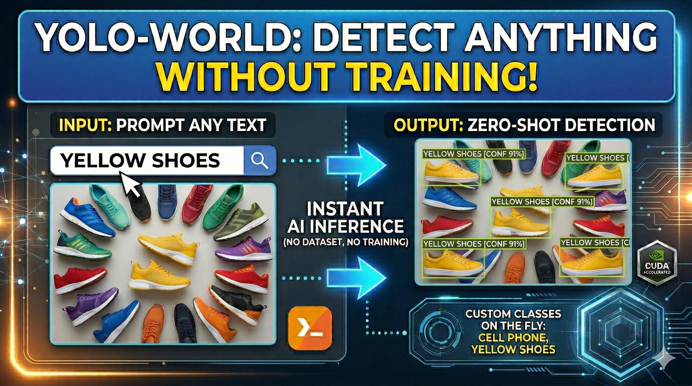

# YOLO World Detect Anything Without Training!

  

##
   

Stop wasting hundreds of hours labeling images. The era of Zero-Shot Object Detection is here! 🚀

In this tutorial, we dive deep into YOLO-World, a state-of-the-art model that allows you to detect any object by simply typing its name. No custom training, no massive datasets, just pure AI power. We will walk through setting up a high-performance environment with Cuda 12.8 and PyTorch 2.9.1, configuring the Ultralytics framework, and saving your own custom-prompted models.

🔍 What You’ll Learn:

✅ Setting up a professional Conda environment for AI.  
✅ Installing GPU-accelerated PyTorch & Ultralytics.  
✅ Implementing YOLO-World for Zero-Shot inference.  
✅ Setting custom classes (e.g., "Yellow shoes") on the fly.  
✅ Visualizing detections with the Supervision library.  

You can find the link for the [tutorial](https://youtu.be/W-TFzi1nGKs) here.  

You can find more cool Object Detection projects and tutorials in this  [playlist](https://www.youtube.com/playlist?list=PLdkryDe59y4YGPdz6bF3pcmFwhJWnawpg)

Enjoy

Eran
   

# Recommended courses and relevant products 

🚀 Want to get started with Computer Vision or take your skills to the next level ? 

If you’re just beginning, I recommend this step-by-step course designed to introduce you to the foundations of Computer Vision - [Complete Computer Vision Bootcamp With PyTorch & TensorFlow](https://trk.udemy.com/9LoE7E) 

If you’re already experienced and looking for more advanced techniques, check out this deep-dive course - [Modern Computer Vision GPT, PyTorch, Keras, OpenCV4](https://trk.udemy.com/EEDyMD)

Before we continue , I actually recommend this [book](https://amzn.to/3STWZ2N) for deep learning based on Tensorflow and Keras : 

# Connect

If you have any suggestions about papers, feel free to mail me :)

- [☕ Buy me a coffee](https://ko-fi.com/eranfeit)
- [🌐 My Website](https://eranfeit.net)
- [▶️ Youtube.com/@eranfeit](https://www.youtube.com/channel/UCTiWJJhaH6BviSWKLJUM9sg)
- [🐙 Facebookl](https://www.facebook.com/groups/3080601358933585)
- [🖥️ Email](mailto:feitgemel@gmail.com)
- [🐦 Twitter](https://twitter.com/eran_feit )
- [😸 GitHub](https://github.com/feitgemel)
- [📸 Instagram](https://www.instagram.com/eran_feit/)
- [🤝 Fiverr ](https://www.fiverr.com/s/mB3Pbb)
- [📝 Medium ](https://medium.com/@feitgemel)

